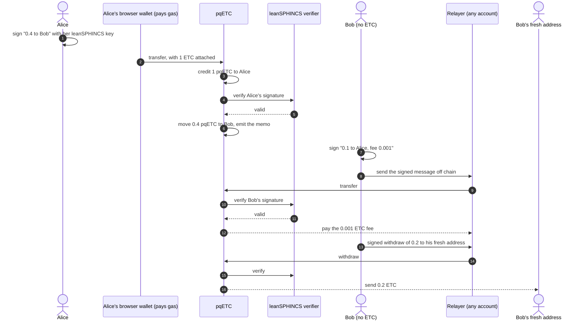

# pq-sig

The first quantum-secure transaction on Ethereum Classic, signed with leanSPHINCS, a stateless hash-based signature from the SPHINCS+ family. Then a web app at pq.classix.dev where anyone can make their own.

This is a proof of concept and an experiment, built for fun. It isn't meant for real use. Nothing here is audited, so don't put in more ETC than you're happy to lose.

Quantum-secure here means a quantum computer can't spend the funds. The gas is still paid by an ordinary account, which only risks its own gas money (see [Current Limitations](#current-limitations)).

## The Approach

ETC has no account abstraction and no [EIP-7702](https://eips.ethereum.org/EIPS/eip-7702). Core-Geth's classic config stops at Spiral, which is Shanghai without withdrawals, so there's no `MCOPY`, no transient storage and no type 2 transaction (see `params/config_classic.go` in Core-Geth). We checked what the chain runs today and designed for that.

What ETC does have is an EVM, Keccak and `CREATE2`. That's enough to check a leanSPHINCS signature in an ordinary contract, with no fork.

The main contract is pqETC, a ledger of wrapped ETC that only leanSPHINCS keys can move. You deposit ETC to a key. From then on every transfer or withdrawal is a message signed by that key, which anyone can submit. The key can sign a fee for whoever submits it, so a holder doesn't need an ECDSA account or any ETC of their own. ETC sent along with a signed transfer is deposited first, so a deposit and a spend fit in one transaction.

Each key shows up as an ordinary 20-byte address, the last 20 bytes of `keccak256(0x10 ‖ PK.seed ‖ PK.root)`. `0x10` is the scheme byte [EIP-8288](https://eips.ethereum.org/EIPS/eip-8288) gives leanSPHINCS. No ECDSA key controls these addresses. pqETC has the ERC-20 read functions and `Transfer` events, so explorers and wallets can show balances, but it has no `transfer` by `msg.sender`, since that would bring ECDSA back.

There's also a contract wallet ([src/LeanSphincsWallet.sol](src/LeanSphincsWallet.sol)) for keys that need to call other contracts. Its only owner check is the same leanSPHINCS signature.

## How It Works

Alice pays Bob, Bob pays back without owning any ETC, then Bob takes ETC out to a fresh address.



Every signed message covers the chain ID, the contract, the sender's nonce, the recipient, the amount, the fee, a deadline and the memo. A relayer can't change any of it, a signature can't be replayed, and a signature from another chain fails.

## The Scheme

We use leanSPHINCS as [EthLib](https://github.com/ethereum/EthLib) specifies it in Lean, at commit [`dce7a2d`](https://github.com/ethereum/EthLib/commit/dce7a2de23a973d84eac38126a1527763cd3465d) from 2026-11-08. It's Tom Wambsgans' layered construction from [sphincs.art](https://sphincs.art), on Keccak-256.

| | |
|---|---|
| hash | Keccak-256 truncated to 16 bytes, in the hash layout of FIPS 205 (SLH-DSA) |
| structure | FORS (24 trees of height 10) under a three-layer hypertree (8 + 8 + 10 from the bottom) with WOTS+C one-time keys |
| public key | 32 bytes, `PK.seed ‖ PK.root` |
| signature | 7,740 bytes |
| lifetime | 2^30 signatures per key, no state kept by the signer |
| verification | 515 Keccak-f permutations, about 86,000 gas |

### Why We Follow the Current Spec

We started on the version EthLib merged on 2026-11-03 ([PR #152](https://github.com/ethereum/EthLib/pull/152)), because [SPHINCS-](https://github.com/nconsigny/SPHINCS-) had a tested EVM verifier for it. Five days later EthLib replaced it. The commit message of [#1555](https://github.com/ethereum/EthLib/commit/dce7a2de23a973d84eac38126a1527763cd3465d) says

> leanSPHINCS now hashes with the layout of FIPS 205 [...] Sizes are unchanged. The unforgeability theorem keeps its statement, 127 bits up to 2^30 signatures, with only the standard axioms.

We moved to it for four reasons.

- It's the version the spec's authors stand behind now. The 2026-11-03 version is superseded, and signatures from one don't verify under the other.
- Its hash layout is FIPS 205's, so anyone who knows SLH-DSA can review it, and EthLib's [README](https://github.com/ethereum/EthLib/tree/main/EthLib/Cryptography/Sphincs) lists every place it departs from the standard.
- Sizes and the security proof are unchanged, so we give up nothing. Verification costs 515 permutations against 492 before.
- EthLib publishes test vectors for it, which our verifier and signer must match byte for byte.

The cost is that no EVM verifier existed for it, so we wrote our own, [src/LeanSphincsVerifier.sol](src/LeanSphincsVerifier.sol), following the structure of the SPHINCS- verifier. It and the TypeScript signer in [signer](signer) reproduce every EthLib test vector byte for byte (vectors in [test/fixtures/ethlib-sphincs](test/fixtures/ethlib-sphincs), CC0). [docs/leanSphincs-fips-layout.md](docs/leanSphincs-fips-layout.md) is a reviewer's summary of the layout. That makes the verifier our code, not a vendored one, and it's unaudited. The spec has changed twice in a week and the [leanSphincs](https://github.com/leanEthereum/leanSphincs) competition hasn't opened yet, so we pin the EthLib commit everywhere and expect to redeploy when it moves.

## Current Limitations

The funds are quantum-secure, but the account that submits the transaction isn't. ETC has no way for a contract to pay its own gas, so an ordinary ECDSA account has to submit every call and pay for it. A quantum attacker who breaks that account can spend its gas money and nothing else. They can't move pqETC, change the call, or replay the signature, because the contract checks the leanSPHINCS signature over all of it. They could only delay a call by refusing to submit it, and anyone else can submit it.

Ethereum's answer is the frame transaction, [EIP-8141](https://eips.ethereum.org/EIPS/eip-8141), a draft from 2026-01-29 with transaction type `0x06`. Its abstract says it

> Adds a new transaction whose validity and gas payment can be defined abstractly.

The account's own code checks the signature in a VERIFY frame and approves the gas payment with a new `APPROVE` opcode, so no ECDSA key is involved at all. The [Devcon workshop](https://github.com/alessandrobaiocchi/Devcon_Workshop) sends exactly that kind of leanSPHINCS transaction on the Daisugi research testnet. ETC would need an ECIP and a hard fork to get frame transactions. Until then, a contract with an ECDSA gas payer is what ETC supports.

Other limits today:

- Nothing here is audited.
- Each signature is 7,740 bytes, so a send costs about 290,000 gas, around 14 times a plain transfer.
- All pqETC sits in one contract, so a bug there affects every holder.
- leanSPHINCS isn't final. A new version means a new verifier and a new ledger.
- The web app keeps keys in the browser's local storage, which suits small amounts only.

## Status

As of 2026-11-10 the contracts, a TypeScript signer, a command-line send script and the pq.classix.dev app are built and tested on a local chain with ETC's rules. Next is the mainnet deploy and the first transaction. Milestones, gas figures and open questions are in [PLAN.md](PLAN.md).

## Building

Tools come from the Nix flake (Foundry, solc, Node).

```sh
git clone --recurse-submodules git@github.com:classix-dev/pq-sig.git
cd pq-sig
nix develop
forge build
forge test
```

## Credits

This builds on other people's work.

- [sphincs.art](https://sphincs.art) by Tom Wambsgans, the leanSPHINCS design. The spec note and the Lean 4 security proofs are in [TomWambsgans/sphincs.art](https://github.com/TomWambsgans/sphincs.art).
- [EthLib](https://github.com/ethereum/EthLib), whose Lean module is the normative leanSPHINCS spec we follow, and whose test vectors we check against.
- [SPHINCS-](https://github.com/nconsigny/SPHINCS-) by Nicolas Consigny (MIT). Our verifier follows the structure of its leanSPHINCS verifier, and its [write-up on ethresear.ch](https://ethresear.ch/t/sphincs-minus-efficient-stateless-post-quantum-signature-verification-on-the-evm/25165) covers the EVM side.
- [Devcon_Workshop](https://github.com/alessandrobaiocchi/Devcon_Workshop) by Alessandro Baiocchi, the Devcon 8 workshop that sends a leanSPHINCS-signed transaction on the Daisugi testnet. pq.classix.dev follows its flow. Its verifier is `SphincsVerifier_v2` from [RivaLabs-Core/Post-Quantum-AA-Infra](https://github.com/RivaLabs-Core/Post-Quantum-AA-Infra/blob/6078fd9306be250dfd12d3b9e57c56688b856a85/src/Verifiers/SphincsVerifier_v2.sol) at commit `6078fd93`.
- The [leanSphincs](https://github.com/leanEthereum/leanSphincs) competition from the Lean Ethereum project.
